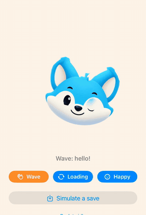

# Kiko: a SwiftUI mascot that reacts to app state

A working SwiftUI example of an animated mascot driven by app state. Kiko is a real
[Charmotion](https://charmotion.app) character: one `.riv` file with a Rive state machine, played by the
official [Rive iOS runtime](https://github.com/rive-app/rive-ios). Tap **Wave**, **Loading** or **Happy**,
or run **Simulate a save** to watch the pattern most apps need: loading while work runs, happy when it lands,
then back to idle.

No account, API key or sign-in. Clone, open, run.

<p align="center"></p>

## Run it

```sh
git clone https://github.com/charmotion/swiftui-mascot-example.git
cd swiftui-mascot-example
open KikoDemo.xcodeproj
```

Pick an iPhone simulator and press Run. Xcode fetches the `RiveRuntime` Swift package on first open.
Requires Xcode 15 or later and iOS 16 or later.

## How it works

The whole integration is one view. App state is a plain Swift value; the view forwards it to the
`mood` number input on the file's `CharacterStateMachine`, and Rive blends into the matching animation.

```swift
import SwiftUI
import RiveRuntime

enum KikoMood: Double { case idle = 0, happy = 1, wave = 2, loading = 5 }

struct KikoView: View {
    var mood: KikoMood
    @StateObject private var kiko = RiveViewModel(fileName: "kiko", stateMachineName: "CharacterStateMachine")

    var body: some View {
        kiko.view()
            .aspectRatio(1, contentMode: .fit)
            .onAppear { kiko.setInput("mood", value: mood.rawValue) }
            .onChange(of: mood) { new in kiko.setInput("mood", value: new.rawValue) }
    }
}
```

Drive it from anything your app already knows:

```swift
mood = .loading
try await api.save(draft)
mood = .happy
```

| File | What it is |
| --- | --- |
| `KikoDemo/kiko.riv` | The character: artwork, rig, animations and the `CharacterStateMachine` |
| `KikoDemo/Kiko.swift` | `KikoMood` and `KikoView`, the part you copy into your app |
| `KikoDemo/ContentView.swift` | The demo screen: three buttons and a fake save |
| `docs/kiko.png` | Kiko as a still PNG (transparent) |

## Mood numbers

Every Charmotion character uses the same `mood` numbers, so the same Swift code drives your own
character when you swap the file.

| Mood | Value | Typical use |
| --- | --- | --- |
| idle | 0 | Always on screen: breathing and blinking |
| happy | 1 | Purchase, level-up, good news |
| wave | 2 | Greeting and onboarding |
| loading | 5 | Loading screens and syncing |

A character file only answers to the moods it was made with; Kiko has these four and more.

## Use your own character

1. Animate your logo or character at [charmotion.app](https://charmotion.app/app-mascot-animation)
   (pick wave, loading, happy and launch; idle is included).
2. Replace `KikoDemo/kiko.riv` with your file and keep the name, or change `fileName:` in `Kiko.swift`.
3. Run. Your set also ships with ready SwiftUI, React and web snippets and a README.

More: [Animated onboarding mascot in SwiftUI](https://charmotion.app/guides/animated-onboarding-mascot-swiftui),
[How to make an animated app mascot](https://charmotion.app/guides/animated-app-mascot),
[MCP server for Claude, Cursor, VS Code and Codex](https://github.com/charmotion/charmotion-mcp).

## License

The Swift code is MIT licensed (see `LICENSE`). Kiko (`kiko.riv`, `kiko.png`, the app icon) is a Charmotion
house character, © TRY2APP LTD: you may use it to try and learn from this example, but not as your own
app's mascot or brand. Rive is a trademark of Rive Inc.; this project is not affiliated with Rive.
